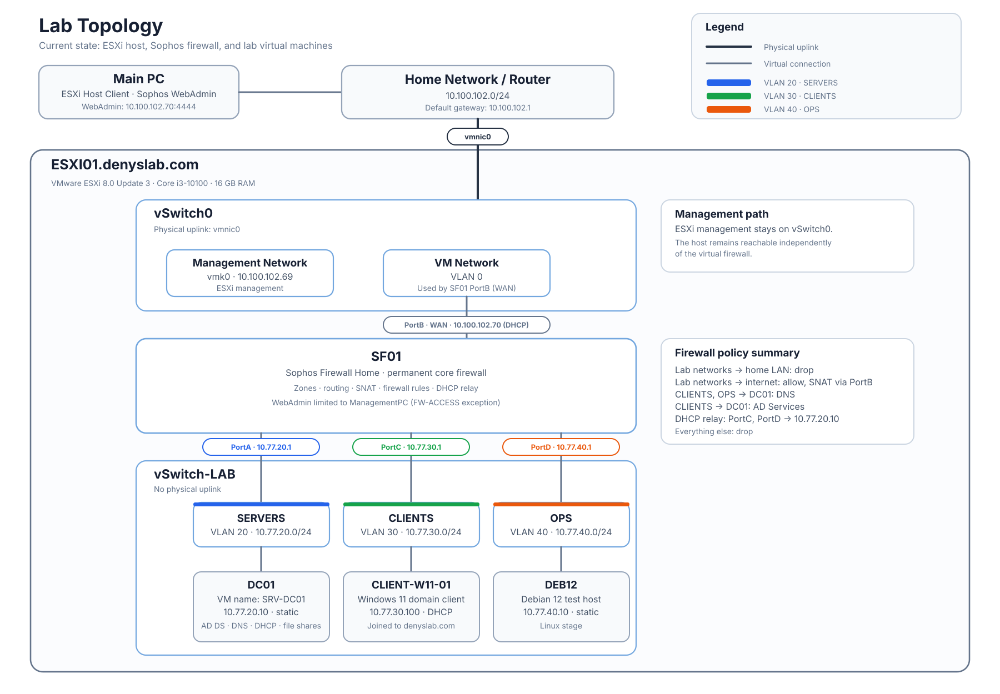

# Infrastructure Homelab

This repository contains my infrastructure homelab built on a dedicated VMware ESXi host.

I am adding each part of the lab as I build and test it.

## Current Environment

- VMware ESXi 8.0 Update 3
- Intel Core i3-10100
- 16 GB RAM
- Dedicated physical ESXi host
- ESXi management network on the home LAN
- Internal lab networks isolated on a separate ESXi virtual switch
- Sophos Firewall Home as the permanent firewall for the lab networks
- Windows Server 2022 running AD DS, DNS, DHCP, and the lab file shares on `DC01`
- Linux services, monitoring, and further backup and recovery work are planned for later stages

## Lab Inventory

| VM | Hostname | Network | Address | Role |
| --- | --- | --- | --- | --- |
| `SF01` | `SF01` | WAN, SERVERS, CLIENTS, OPS | WAN `10.100.102.70` (DHCP); gateways `10.77.20.1`, `10.77.30.1`, `10.77.40.1` | Sophos Firewall Home |
| `SRV-DC01` | `DC01` | SERVERS (VLAN 20) | `10.77.20.10` (static) | AD DS, DNS, DHCP, file shares |
| `CLIENT-W11-01` | `CLIENT-W11-01` | CLIENTS (VLAN 30) | `10.77.30.100` (DHCP, as captured) | Windows 11 domain client |
| `DEB12` | `DEB12` | OPS (VLAN 40) | `10.77.40.10` (static) | Debian 12 test host |

## Current Status

- ✅ [ESXi installed and accessible through the Host Client over local network](docs/1-hardware-and-host.md)
- ✅ [ESXi network foundation](docs/2-esxi-networking.md)
- ✅ [Sophos Firewall core](docs/3-sophos-firewall.md)
- ✅ [Active Directory and DNS](docs/4-active-directory-dns.md)
- ✅ [DHCP and Windows client](docs/5-dhcp-and-windows-client.md)
- ✅ [OUs, Group Policy, and file access](docs/6-ou-gpo-and-file-access.md)
- ⬜ Linux services and Docker
- ⬜ Monitoring
- ⬜ Backup and restore testing
- ⬜ Vendor firewall lab
- ⬜ Hybrid Microsoft 365 stage

## What This Lab Demonstrates

- VMware ESXi: standard vSwitches, VLAN-backed port groups, host management kept separate from the guest networks
- Sophos Firewall: zones, routing, SNAT, ordered firewall rules, DHCP relay, scoped device access, log-based validation
- Windows Server 2022: AD DS, DNS with forwarders, DHCP, OUs, security groups (AGDLP), Group Policy, file shares with NTFS permissions
- Windows 11 domain client: DHCP, domain join, GPO and mapped-drive checks with `gpresult` and `net use`
- Documented stages using Requirement, Design, Implementation, Validation, and Troubleshooting where applicable

## Known Limitations

- One host with 16 GB of RAM, so the always-on footprint is small and the file shares live on `DC01`.
- One domain controller, with no tested system or data restore procedure yet. A Sophos configuration export is stored off-host, but it has not been restore-tested.
- Windows Server 2022 is an evaluation build. The Windows 11 license status has not been verified for this documentation update.
- `denyslab.com` is used as the internal AD DNS namespace (see [4-active-directory-dns.md](docs/4-active-directory-dns.md)). Ownership of the public DNS domain is not documented here.

## Repository Structure

- `docs/` – documentation for completed stages
- `diagrams/` – network diagrams
- `screenshots/` – evidence for documented steps
