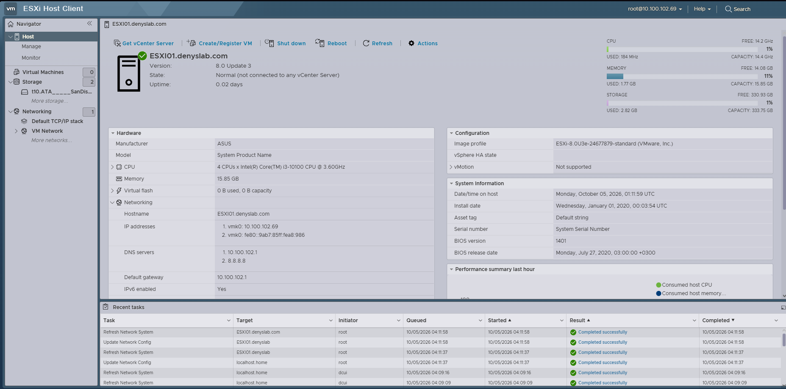

# ESXi Host

I installed VMware ESXi 8.0 Update 3 on a dedicated PC that runs the infrastructure VMs for this lab.

## Host

- ASUS H410M-A
- Intel Core i3-10100 @ 3.60 GHz
- 16 GB RAM
- 512 GB SSD (the ESXi Host Client showed approximately 334 GB as the VMFS datastore)

The machine was originally planned with 32 GB of RAM, but one motherboard RAM slot is not working. I decided to continue with the current hardware and keep the VM footprint small instead of delaying the lab for an upgrade.

I may add another 256 GB SSD later if I need more room for temporary VMs and vendor firewall labs.

## ESXi

Installed version:

- VMware ESXi 8.0 Update 3
- Image profile: `ESXi-8.0U3e-24677879-standard`
- Hostname: `ESXI01.denyslab.com`
- Management IP: `10.100.102.69`
- Gateway: `10.100.102.1`

I manage the host from my main PC through the ESXi Host Client.

After installation, the host clock was incorrect. I corrected the host time using `il.pool.ntp.org` as the NTP server before moving on. Services such as Active Directory and logging depend on accurate time.

The screenshot below shows the host after the initial setup, with the hostname, ESXi version, hardware information, management IP, and corrected host time.

## Resource limits

With no VMs running, ESXi showed about 14 GB of free memory. I left some of that for the hypervisor and VM overhead rather than assigning it all to guests.

I don't keep all four VMs running at once. The Windows client is mainly powered on for tests.

The ESXi network layout is documented separately in [2-esxi-networking.md](2-esxi-networking.md).
