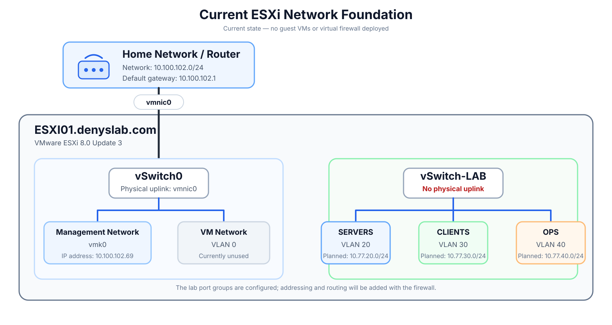
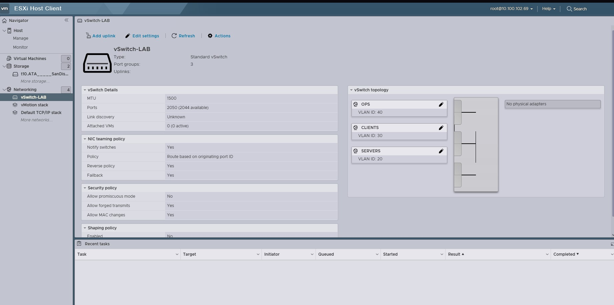

# ESXi Networking

The ESXi network foundation keeps host management independent from the virtual firewall and separates the internal lab networks on an isolated virtual switch.

The diagram below is the Phase 3 design snapshot from before the firewall VM was deployed.

`vSwitch0` is connected to the home LAN through `vmnic0`. ESXi management remains on this switch through `vmk0` at `10.100.102.69`.

The default `VM Network` port group is now used by `SF01` for its WAN interface. This keeps the firewall connected to the upstream home network without placing ESXi management behind the firewall.

`vSwitch-LAB` has no physical uplink. It carries the three internal lab port groups:

| Port group | VLAN | Subnet | Gateway | Intended use |
| --- | ---: | --- | --- | --- |
| `SERVERS` | 20 | `10.77.20.0/24` | `10.77.20.1` | Infrastructure servers |
| `CLIENTS` | 30 | `10.77.30.0/24` | `10.77.30.1` | Client systems |
| `OPS` | 40 | `10.77.40.0/24` | `10.77.40.1` | Monitoring, backup, and administration |

The gateway addresses are configured on Sophos Firewall interfaces. ESXi does not have a VMkernel interface on `vSwitch-LAB`.

VLAN tagging is configured on the ESXi port groups. Each internal `SF01` vNIC is attached to one VLAN-backed port group, so ESXi handles the VLAN assignment before traffic reaches the guest. `SF01` does not receive an 802.1Q trunk and does not use VLAN subinterfaces for these networks.

- `PortA` → `SERVERS`
- `PortC` → `CLIENTS`
- `PortD` → `OPS`

`PortB` is attached to `VM Network` for WAN access.

## ESXi Host Client

  

*ESXi Host Client showing the three lab port groups on `vSwitch-LAB` and no physical adapter attached.*

The firewall deployment and policy validation are documented in [3-sophos-firewall.md](3-sophos-firewall.md).
