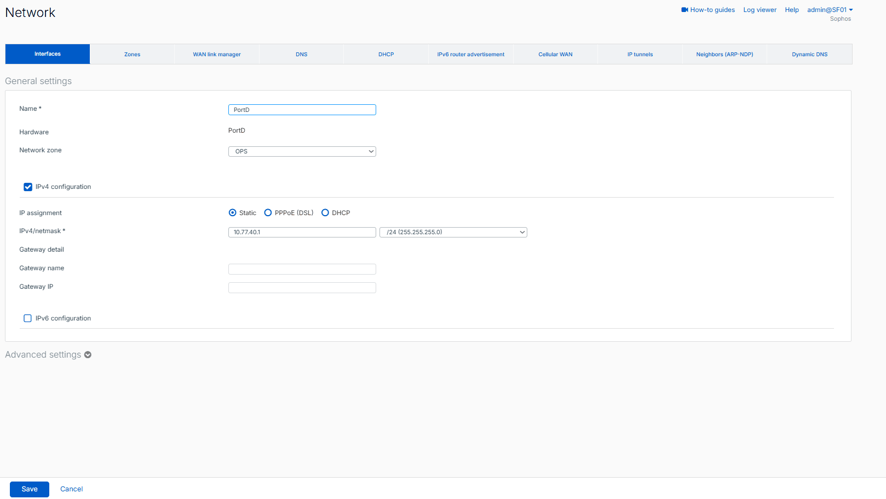

# Sophos Firewall Core

I deployed Sophos Firewall Home as the permanent firewall for the lab. The requirement was to route the three internal lab networks, give them controlled internet access, and keep lab traffic away from the home LAN by default.

## Requirement

The firewall needed to provide a stable core for later Active Directory, Linux, monitoring, and backup work. I also wanted ESXi management to stay reachable if the firewall VM was stopped or misconfigured.

The baseline for this stage was:

- separate `SERVERS`, `CLIENTS`, and `OPS` networks
- internet access through source NAT
- an explicit deny from the lab to the home LAN
- no general inter-zone allow rules yet
- management access from my main PC without exposing WebAdmin to the whole WAN zone

## Design

I kept ESXi management on `vSwitch0` and placed the three lab networks on the isolated `vSwitch-LAB`. Sophos uses one virtual NIC for each network instead of an 802.1Q trunk inside the firewall VM.

### SF01 VM

- Sophos Firewall OS 22.0.2 MR-2 Build 546
- 1 vCPU
- 4 GB RAM
- 32 GB system disk
- 80 GB auxiliary disk
- 4 virtual NICs

The installed ESXi license limited this VM to one vCPU in my setup, so I kept the firewall at one vCPU instead of delaying the lab.

  

*SF01 VM resources and the four ESXi network assignments.*

### Interfaces

| Sophos port | Zone | ESXi port group | Address | Role |
| --- | --- | --- | --- | --- |
| `PortA` | `SERVERS` | `SERVERS` | `10.77.20.1/24` | Server network gateway |
| `PortB` | `WAN` | `VM Network` | `10.100.102.70/24` via DHCP | Upstream home network |
| `PortC` | `CLIENTS` | `CLIENTS` | `10.77.30.1/24` | Client network gateway |
| `PortD` | `OPS` | `OPS` | `10.77.40.1/24` | Operations network gateway |

During bootstrap, `PortA` temporarily used `172.16.16.16/24`. After I matched the Sophos ports to the ESXi vNICs by MAC address, I moved `PortA` to `SERVERS` and assigned the final gateway address.

  

*`PortD` configured as the `OPS` gateway at `10.77.40.1/24`.*

I kept ESXi management at `10.100.102.69` on `vSwitch0`, outside the lab firewall path.

## Implementation

### Firewall policy

I created a deny rule above the internet rules so lab traffic cannot use the WAN path to reach the home subnet.

| Rule | Source | Destination | Action |
| --- | --- | --- | --- |
| `LAB_TO_HOME_DENY` | `SERVERS`, `CLIENTS`, `OPS` | `HOME_LAN` (`10.100.102.0/24`) through `WAN` | Drop |
| `SERVERS_TO_INTERNET` | `SERVERS` | `WAN` | Accept |
| `CLIENTS_TO_INTERNET` | `CLIENTS` | `WAN` | Accept |
| `OPS_TO_INTERNET` | `OPS` | `WAN` | Accept |

I disabled the automatically added MTA policy and the original `#Default_Network_Policy`. The built-in final `Drop all` rule remains in place.

  

*Baseline rule order with the lab-to-home deny above the three internet allow rules.*

### NAT

I used `Default SNAT IPv4` for outbound traffic. It masquerades the source address and sends traffic out through `PortB`.

  

*`Default SNAT IPv4` uses MASQ and `PortB` for outbound traffic.*

The older linked NAT entries are still visible because Sophos created them with the original default policies, but their parent firewall policies are disabled.

### Management access

I administer Sophos WebAdmin from my main PC through `PortB` at `10.100.102.70:4444`.

Because `PortB` is in the `WAN` zone, I did not enable WebAdmin access for every host on that zone. I created the local service ACL exception `FW-ACCESS` for the `ManagementPC` host object instead.

## Validation

I tested the firewall with one system in each internal network. Public DNS was used only for this stage; domain clients will use the domain DNS service after `DC01` is deployed.

### SERVERS

The Windows Server test system used `10.77.20.10/24` with gateway `10.77.20.1`. It reached `8.8.8.8` and resolved `google.com`. A ping to the home router at `10.100.102.1` timed out.

  

*`SERVERS` validation: internet and DNS work, while the home-router ping fails.*

### CLIENTS

The Windows 11 test system used `10.77.30.10/24` with gateway `10.77.30.1`. It reached `8.8.8.8` and resolved `google.com`. The saved test also shows that a ping to the `SERVERS` test host timed out.

  

*`CLIENTS` validation: the client has the expected address and gateway and can reach the internet.*

### OPS

The Debian 12 test system used `10.77.40.10/24`. It reached `8.8.8.8` and `google.com`, while pings to the home router and the `SERVERS` test host timed out.

  

*`OPS` validation from `10.77.40.10/24`.*

### Firewall log

The final Sophos log gives the strongest policy evidence. It shows `OPS_TO_INTERNET` and `SERVERS_TO_INTERNET` traffic allowed through `PortB`, with `Default SNAT IPv4` applied. The same capture shows `10.77.40.10` traffic to `10.100.102.1` denied by `LAB_TO_HOME_DENY`.

  

*Allowed internet traffic with SNAT and denied `OPS` traffic to the home LAN in the same log view.*

The endpoint screenshots also contain failed cross-zone ICMP tests. I am treating those only as reachability checks, not as proof of the exact filtering component, because I did not capture a matching final-drop log entry and an endpoint firewall can also block ICMP.

## Troubleshooting

### Gateway ping failed

The server in `SERVERS` initially could not ping `10.77.20.1`. I first checked the IP configuration and transit firewall rules, but the missing control was under Sophos Device Access.

Traffic addressed to the firewall itself is controlled separately from traffic passing through it. After I enabled `Ping` for the `SERVERS` zone, the gateway responded. I also enabled DNS resolution there during the validation stage.

### Windows client had internet connectivity but no DNS

The Windows 11 client could ping `8.8.8.8`, but hostname lookups and browser access failed with `DNS_PROBE_FINISHED_BAD_CONFIG`. This showed that the gateway, firewall rule, SNAT, and WAN path were already working.

I configured `8.8.8.8` and `1.1.1.1` as temporary DNS servers and repeated the test. Name resolution then worked. These public DNS settings are temporary; the final domain-client design will use `DC01` for DNS.

### Interface mapping during bootstrap

The first setup stage used the default `172.16.16.16` address on `PortA`. Before moving the firewall to the final lab networks, I checked the ESXi virtual NIC MAC addresses against the Sophos ports. This avoided assigning `SERVERS`, `CLIENTS`, or `OPS` to the wrong interface.

## Configuration Backup

After the baseline validation, I exported the Sophos configuration and saved it on my main PC outside the ESXi datastore.

I did not add the firewall export to this repository because it can contain sensitive configuration data. I have not performed a restore test yet, so this is a saved configuration copy, not a verified recovery procedure.

## Result

At the end of this stage, `SF01` routes the three internal lab networks to the internet through `PortB`, applies source NAT, and blocks the lab from the home LAN with an explicit logged rule. ESXi management remains independent from the firewall.

I have not added Active Directory-specific traffic rules or general inter-zone allow rules yet. The next infrastructure stage is `DC01` with AD DS and DNS.
