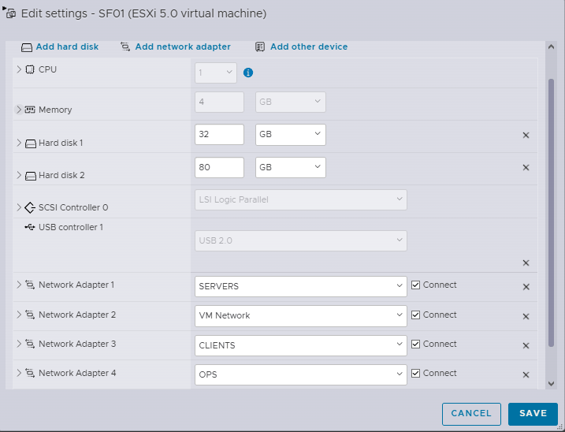
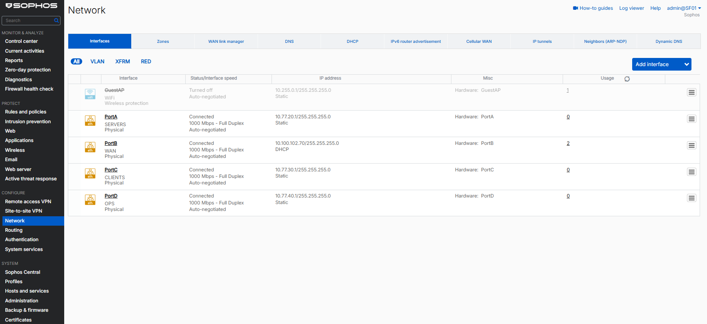
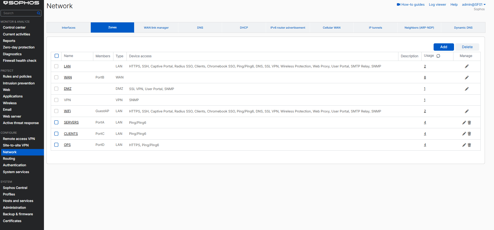
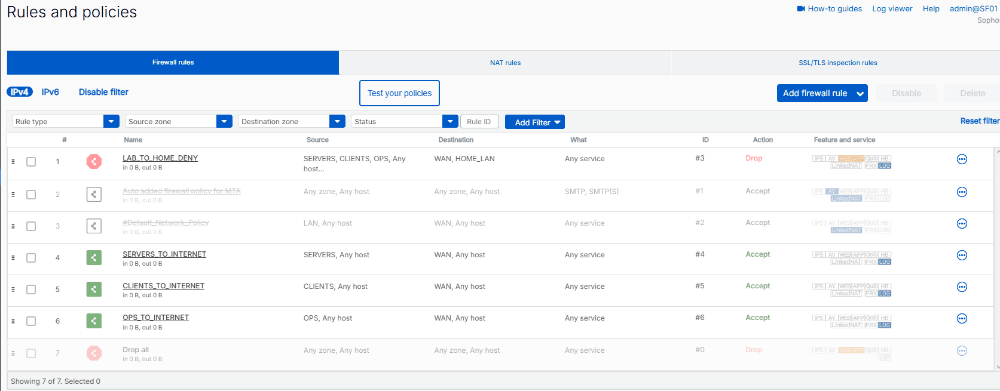
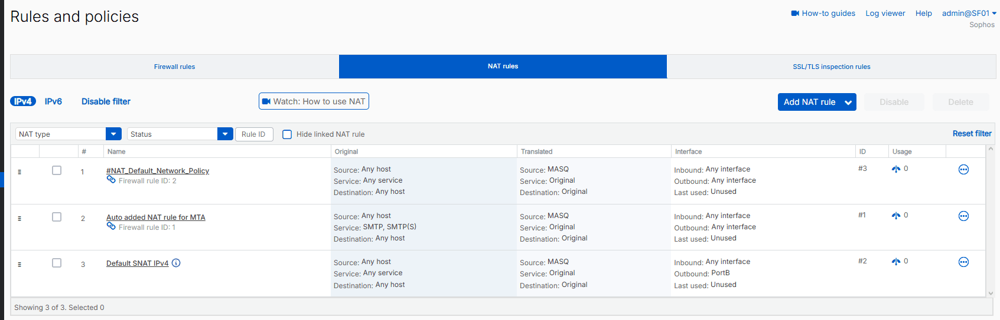
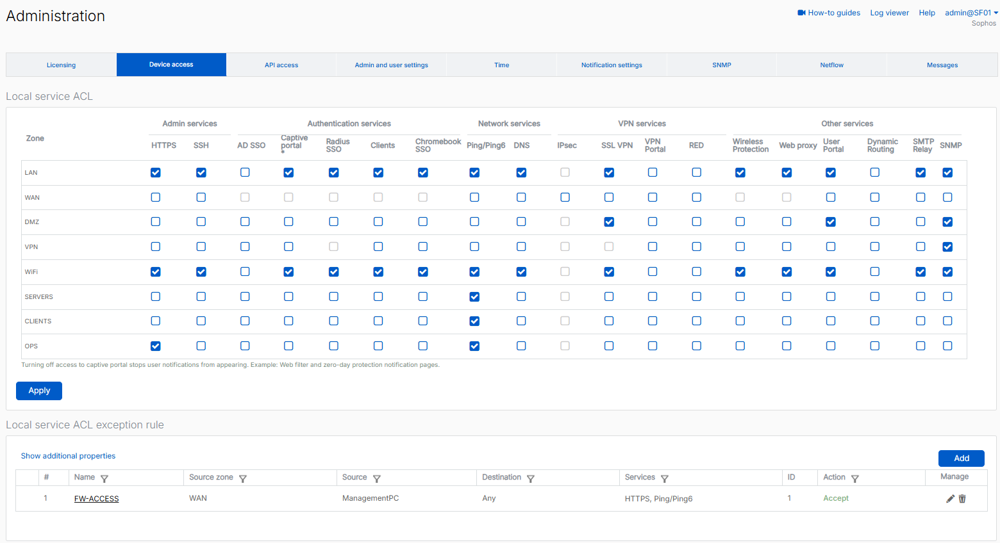
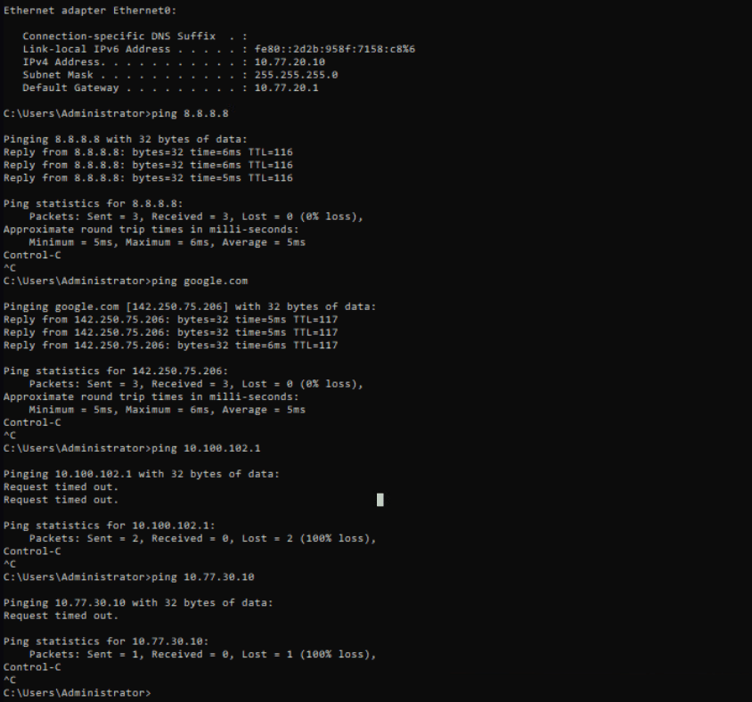
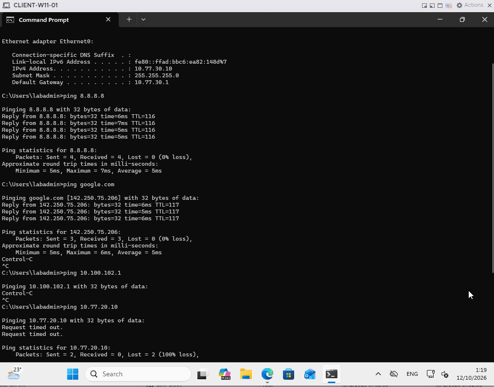
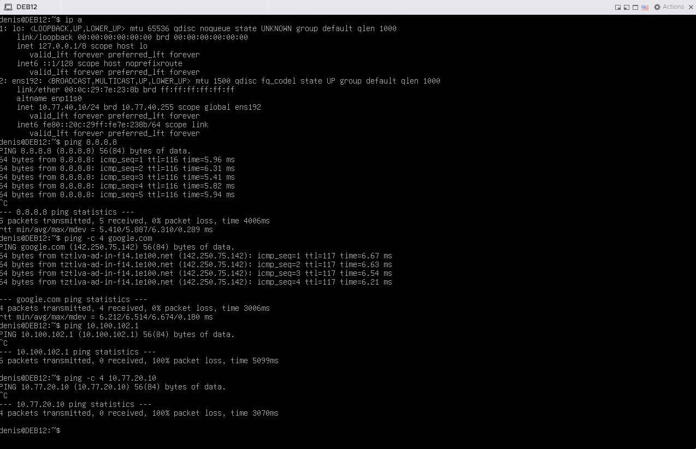
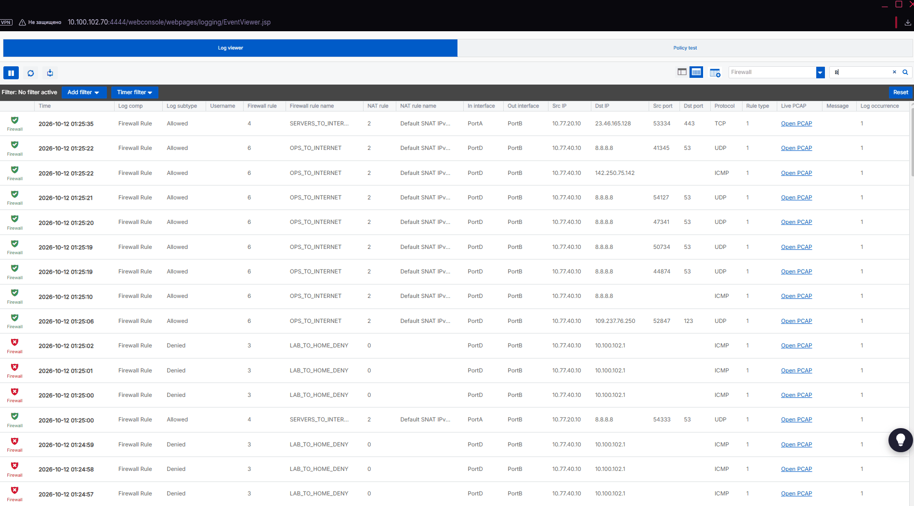

# Sophos Firewall Core

I deployed Sophos Firewall Home as the permanent firewall for the lab. This stage established routing, internet access, NAT, and a restrictive policy baseline before adding Active Directory or other infrastructure services.

## Requirement

For this stage I needed the firewall to:

- route the `SERVERS`, `CLIENTS`, and `OPS` networks
- provide controlled internet access through the home connection
- block lab access to the home LAN by default
- keep ESXi management independent from the firewall VM
- allow Sophos WebAdmin access from my main PC without exposing it to the whole WAN zone

I did not add general inter-zone allow rules at this point. Those rules will be added later only when a service needs them.

## Design

ESXi management stays on `vSwitch0` at `10.100.102.69`. The firewall WAN interface also connects to the home network through `vSwitch0`, while the 3 internal interfaces connect to the isolated `vSwitch-LAB`.

VLAN tagging is handled by ESXi at the port-group level. `SERVERS`, `CLIENTS`, and `OPS` use VLAN IDs 20, 30, and 40. Each `SF01` vNIC is connected to one VLAN-backed port group, we do not use an 802.1Q trunk or VLAN subinterfaces.

### SF01 VM

- Sophos Firewall OS 22.0.2 MR-2 Build 546
- 1 vCPU
- 4 GB RAM
- 32 GB system disk
- 80 GB auxiliary disk
- 4 virtual NICs

The host's current ESXi licensing/configuration limited this VM to one vCPU, so I kept the firewall at one vCPU.

  

*SF01 VM resources and ESXi network assignments.*

### Interface and zone mapping

| Sophos port | Zone | ESXi port group | VLAN | Address | Role |
| --- | --- | --- | ---: | --- | --- |
| `PortA` | `SERVERS` | `SERVERS` | 20 | `10.77.20.1/24` | Server network gateway |
| `PortB` | `WAN` | `VM Network` | — | `10.100.102.70/24` via DHCP | Upstream home network |
| `PortC` | `CLIENTS` | `CLIENTS` | 30 | `10.77.30.1/24` | Client network gateway |
| `PortD` | `OPS` | `OPS` | 40 | `10.77.40.1/24` | Operations network gateway |

  

*Final interface assignments: `PortA/SERVERS`, `PortB/WAN`, `PortC/CLIENTS`, and `PortD/OPS`.*

  

*Final zone membership and device-access settings for the lab interfaces.*

The three lab networks are directly connected to `SF01`, so they do not need separate static routes. Firewall policy determines whether traffic is allowed between those connected networks.

During the initial bootstrap, `PortA` temporarily used `172.16.16.16/24`. Before assigning the final networks, I matched the Sophos ports to the ESXi vNICs by MAC address. This prevented a port-group mapping mistake when the four interfaces were reassigned.

## Implementation

### Firewall policy

I placed the lab-to-home deny rule above the internet rules so traffic for `10.100.102.0/24` is dropped before a general WAN allow rule can match it.

| Rule | Source | Destination | Service | Action |
| --- | --- | --- | --- | --- |
| `LAB_TO_HOME_DENY` | `SERVERS`, `CLIENTS`, `OPS` | `WAN` / `HOME_LAN` (`10.100.102.0/24`) | Any | Drop |
| `SERVERS_TO_INTERNET` | `SERVERS` | `WAN` | Any | Accept |
| `CLIENTS_TO_INTERNET` | `CLIENTS` | `WAN` | Any | Accept |
| `OPS_TO_INTERNET` | `OPS` | `WAN` | Any | Accept |

Logging is enabled on these rules. I disabled the automatically added MTA rule and the original `#Default_Network_Policy`. Unmatched traffic still falls to the built-in final `Drop all` rule.

  

*Final rule order for the baseline.*

No rule currently permits general traffic between `SERVERS`, `CLIENTS`, and `OPS`.

### NAT

Outbound lab traffic uses `Default SNAT IPv4`. The source address is translating and traffic leaves through `PortB`.

  

*`Default SNAT IPv4` provides outbound address translation through `PortB`.*

The older linked NAT entries remain visible because Sophos created them with the original default policies. Their parent firewall policies are disabled.

### Management access

I administer Sophos WebAdmin from my main PC at `10.100.102.70:4444`. Because `PortB` belongs to the `WAN` zone, I did not gave access to WebAdmin for the whole zone. A local service ACL exception named `FW-ACCESS` limits this management path to the `ManagementPC` host object.

Device access on the internal zones is also kept narrow. The final zone configuration allows `Ping/Ping6` on `SERVERS` and `CLIENTS`; `OPS` allows HTTPS and `Ping/Ping6`. The `FW-ACCESS` exception permits HTTPS and `Ping/Ping6` from `ManagementPC` in the `WAN` zone.

  

*Local firewall access is limited by zone-level Device Access settings and the `FW-ACCESS` exception for the management PC.*

## Validation

I tested the baseline with one system in each internal network. Public DNS was used temporarily for these checks. Domain clients will use the domain DNS service after `DC01` is deployed.

| Test system | Network and address | Internet by IP | DNS resolution | Home LAN reachability |
| --- | --- | --- | --- | --- |
| Windows Server | `SERVERS` — `10.77.20.10/24` | Pass | Pass | No reply |
| Windows 11 | `CLIENTS` — `10.77.30.10/24` | Pass | Pass | No reply |
| Debian 12 | `OPS` — `10.77.40.10/24` | Pass | Pass | No reply |

### Endpoint checks

  

*`SERVERS`: internet and DNS checks pass; the home-router ping receives no reply.*

  

*`CLIENTS`: the client has the expected address and gateway and can reach the internet.*

  

*`OPS`: internet and DNS checks pass; home-LAN and cross-zone pings receive no reply.*

### Firewall log

The firewall log provides the policy evidence. It shows internet traffic from the lab allowed by the matching zone rule with `Default SNAT IPv4` applied, and lab traffic to `10.100.102.1` denied by `LAB_TO_HOME_DENY`.

  

*Allowed internet traffic with SNAT and denied lab-to-home traffic in the same log view.*

I also ran cross-zone ICMP checks from the test systems. Those pings timed out, but I did not capture a matching final-drop log entry. I therefore treat them as endpoint reachability checks.

### Configuration backup

After validation, I exported the Sophos configuration and saved the copy on my main PC, outside the ESXi datastore and outside this repository.

I have not performed a restore test yet. The export is a saved configuration copy, not a verified recovery procedure.

## Troubleshooting

### Gateway ping failed from SERVERS

The Windows Server test system initially could not ping its gateway at `10.77.20.1`. The interface addressing and transit policy were already correct, so I checked Sophos Device Access.

The cause was that ICMP to the firewall itself was not enabled for the `SERVERS` zone. After I enabled `Ping`, the gateway responded and I continued with the internet and policy tests. This also confirmed the distinction between Device Access, which controls services terminating on the firewall, and firewall rules, which control forwarded traffic.

### Windows client had IP connectivity but no DNS

The Windows 11 client could ping `8.8.8.8`, but hostname lookups and browser access failed with `DNS_PROBE_FINISHED_BAD_CONFIG`. The successful IP test showed that the client gateway, firewall rule, SNAT, and WAN path were working.

I configured `8.8.8.8` and `1.1.1.1` as temporary DNS servers and repeated the test. Name resolution then worked. These public resolvers are only a temporary validation setting; the domain design will use `DC01` for DNS.
