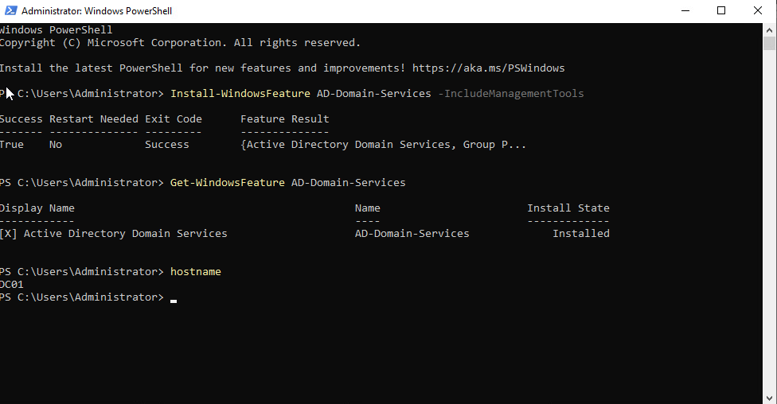
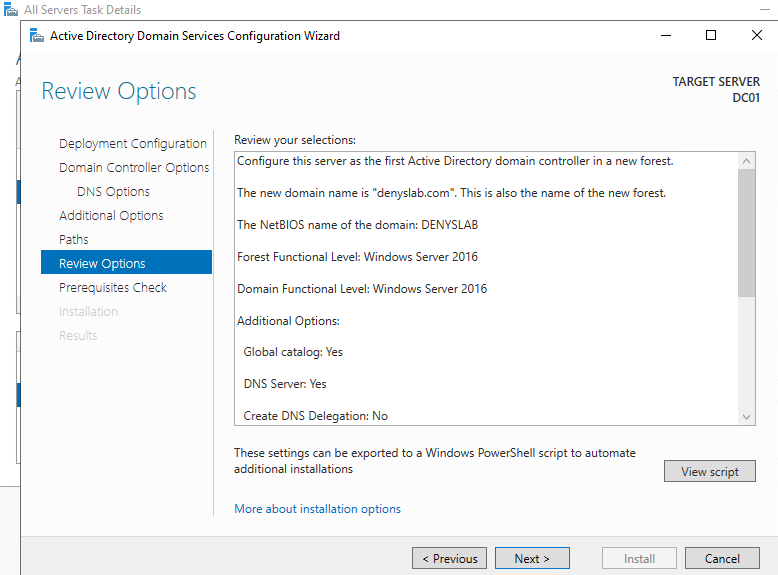
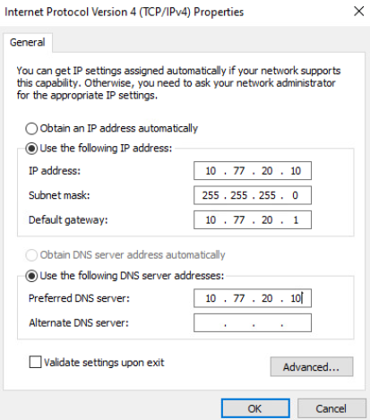
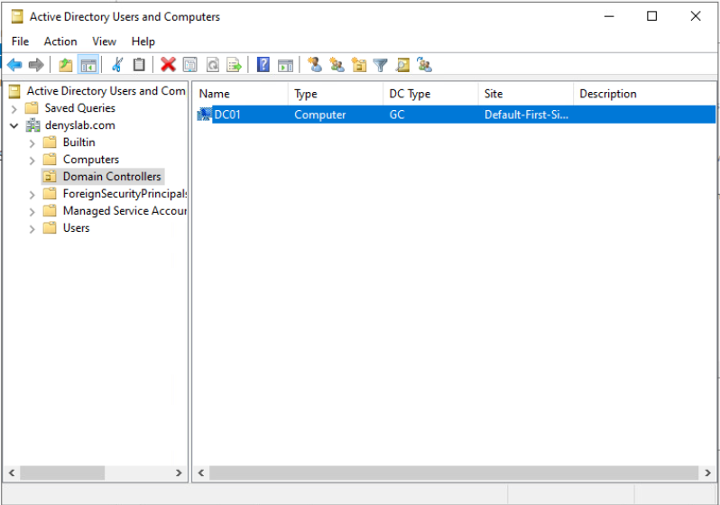
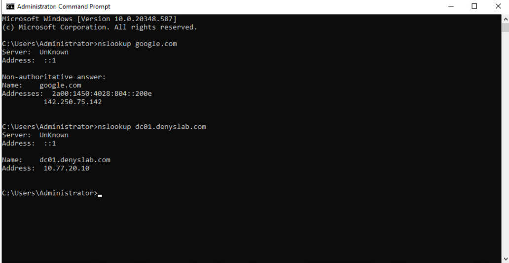
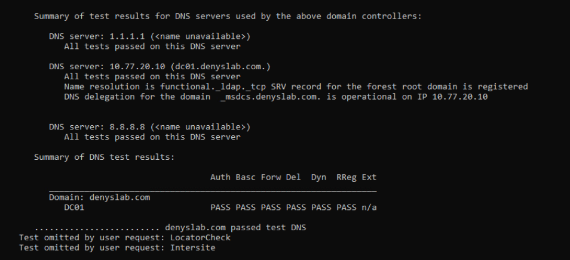

# Active Directory and DNS

I installed Active Directory Domain Services and DNS on `DC01` and created the `denyslab.com` forest. This is the first domain controller in the lab.

## Requirement

I needed a domain controller on the `SERVERS` network, with a static IP and DNS for both Active Directory records and internet lookups.

## Design

| Setting | Value |
| --- | --- |
| Server | `DC01`, Windows Server 2022 Standard Evaluation |
| Domain | `denyslab.com` (`DENYSLAB`) |
| Network | `SERVERS`, VLAN 20 |
| Address | `10.77.20.10/24` |
| Gateway | `10.77.20.1` (Sophos `PortA`) |
| Preferred DNS | `10.77.20.10` |
| DNS forwarders | `8.8.8.8`, `1.1.1.1` |
| Domain and forest functional levels | Windows Server 2016 |

`DC01` uses its own DNS service for domain lookups. The public DNS servers are configured as forwarders, not as alternate DNS servers on the network adapter. DNS Server and Global Catalog are enabled on the domain controller.

## Implementation

I renamed the Windows Server VM to `DC01` and installed the AD DS role and management tools.

*AD DS installed on `DC01`.*

I created a new forest named `denyslab.com` with the Server Manager promotion wizard. I kept the domain and forest functional levels at Windows Server 2016, enabled DNS Server and Global Catalog, and rebooted after promotion.

*Forest settings selected during domain controller promotion.*

I set the adapter's preferred DNS server to `10.77.20.10` and configured `8.8.8.8` and `1.1.1.1` as DNS forwarders.

*Static IPv4 address and local DNS server on `DC01`.*

## Validation

In Active Directory Users and Computers, `DC01` appears in the `Domain Controllers` container as a Global Catalog.

*`DC01` in the `denyslab.com` Domain Controllers container.*

I checked DNS from `DC01`:

- `nslookup dc01.denyslab.com` returned `10.77.20.10`.
- `nslookup google.com` returned public IP addresses.

*Local domain and external DNS lookups.*

`dcdiag /test:dns /v` passed the reported DNS checks, including the forest-root LDAP SRV record and `_msdcs.denyslab.com` delegation.

*DNS test results for `DC01`.*

I also checked `net share` and found both `SYSVOL` and `NETLOGON`. A separate `dcdiag /q` run reported `DFSREvent` and `SystemLog` entries from the Windows event logs.

## Next stage

Windows DHCP, Sophos DHCP relay, and Windows client domain join are covered in [DHCP and Windows Client](5-dhcp-and-windows-client.md).