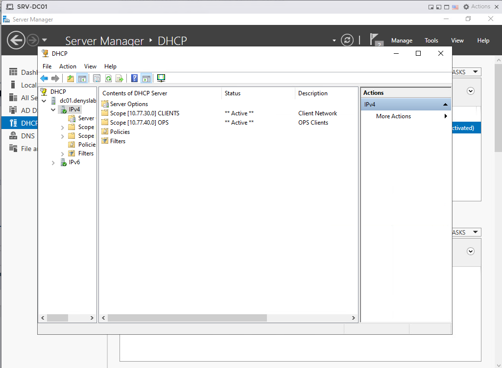
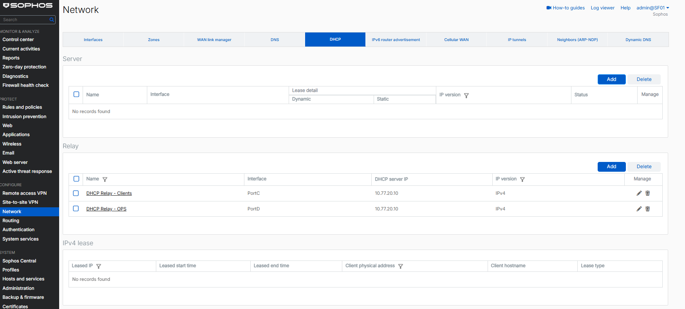
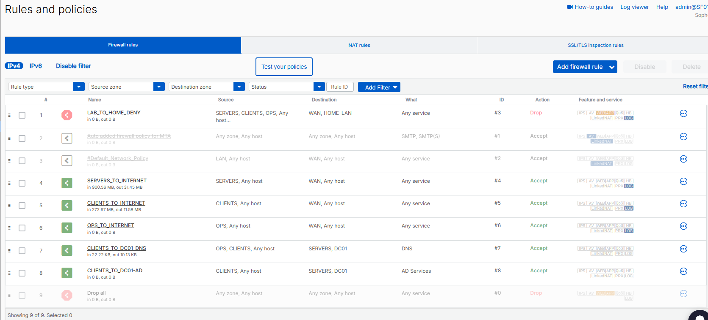
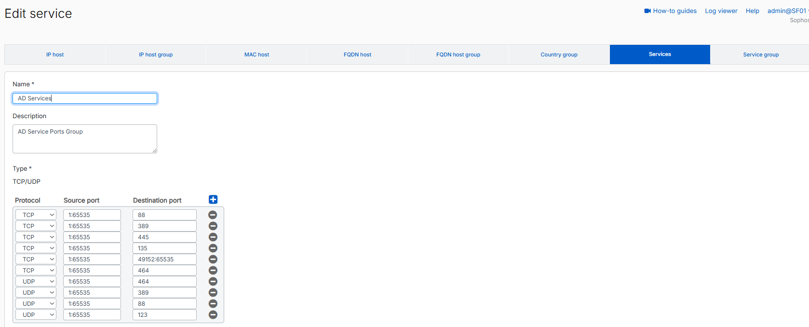
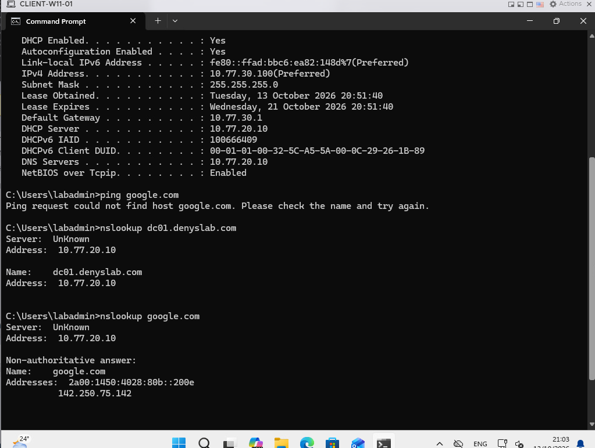
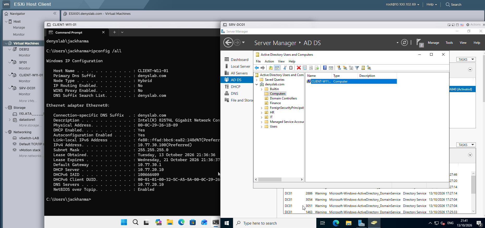

# DHCP and Windows Client

I moved IP address assignment for `CLIENTS` and `OPS` to Windows DHCP on `DC01`. Sophos forwards DHCP requests from both networks to the server. I then joined a Windows 11 VM to `denyslab.com` and tested a domain user sign-in.

## Requirement

The client networks needed DHCP without putting a DHCP server in every subnet. Windows clients also needed to use the domain DNS server and reach `DC01` for domain join, while the firewall continued to block unrelated traffic between the lab networks.

## Design

`DC01` stays on a static address (`10.77.20.10`) in the `SERVERS` network. I chose Windows DHCP rather than Sophos DHCP so I could manage the address pools and DNS options from Windows Server. Sophos acts only as the DHCP relay for the other two networks.

| Network | DHCP scope | Gateway (option 003) | DNS (option 006) |
| --- | --- | --- | --- |
| `CLIENTS` (`10.77.30.0/24`) | `10.77.30.100–199` | `10.77.30.1` | `10.77.20.10` |
| `OPS` (`10.77.40.0/24`) | `10.77.40.100–199` | `10.77.40.1` | `10.77.20.10` |

Both scopes use `denyslab.com` for DHCP option 015. I kept the lower addresses outside the pools for systems that need static addressing. `SERVERS` does not have a DHCP scope at this stage.

## Implementation

### Windows DHCP

I installed DHCP Server on `DC01` and created the `CLIENTS` and `OPS` scopes. Both are active in DHCP Manager. The lease duration is eight days.

*Both IPv4 scopes are active on `DC01`.*

### Sophos DHCP relay

DHCP broadcasts cannot travel directly from `CLIENTS` or `OPS` to `DC01`, because the networks are separated by Sophos. I configured two IPv4 relay entries:

- `PortC` (`CLIENTS`) → `10.77.20.10`
- `PortD` (`OPS`) → `10.77.20.10`

I did not enable a DHCP server on Sophos.

*`PortC` and `PortD` relay DHCP requests to `DC01`.*

### Access to the domain controller

The client got its DHCP lease through the relay, but it still needed normal routed access to `DC01` for DNS and domain services. I added two firewall rules above the final drop rule:

| Rule | Source | Destination | Service |
| --- | --- | --- | --- |
| `CLIENTS_TO_DC01-DNS` | `CLIENTS`, `OPS` | `DC01` in `SERVERS` | DNS |
| `CLIENTS_TO_DC01-AD` | `CLIENTS` | `DC01` in `SERVERS` | `AD Services` |

The first rule also serves `OPS`, which uses `DC01` for DNS. I kept AD access separate so OPS does not receive the same domain-service access as Windows clients. Both rules use a specific destination host rather than opening all traffic to `SERVERS`. No additional SNAT is needed for this internal traffic.

*DNS and domain-service traffic have separate allow rules.*

I made a custom `AD Services` service object for the Windows client rule. It contains TCP 88, 389, 445, 135, 464 and 49152–65535, plus UDP 88, 389, 464 and 123. DNS (TCP/UDP 53) remains in its own rule. `Match known users` is not enabled: a workstation must be able to contact a domain controller before Sophos knows which domain user is signing in.

*The service object limits the rule to the AD ports configured for this lab.*

## Validation

### DHCP and DNS

I switched `CLIENT-W11-01` from a static IPv4 configuration to DHCP. `ipconfig /all` showed:

- Address: `10.77.30.100/24`
- Gateway: `10.77.30.1`
- DHCP server: `10.77.20.10`
- DNS server: `10.77.20.10`
- DNS suffix: `denyslab.com`

The client resolved `dc01.denyslab.com` to `10.77.20.10` and `google.com` to public IP addresses using `DC01` as its DNS server.

*Internal and external DNS lookups work through `DC01`.*

### Domain join and sign-in

I joined `CLIENT-W11-01` to `denyslab.com` and signed in with the test domain account `DENYSLAB\jackhanma`. On `DC01`, Active Directory Users and Computers shows the client's computer object in the default `Computers` container. The same view shows the client still using the DHCP address and domain DNS settings.

*Domain sign-in on the Windows 11 client and its computer account in AD.*

The `OPS` scope and relay are configured and visible, but I have not recorded an OPS endpoint receiving a lease from Windows DHCP yet. 
## Troubleshooting

### Client received DHCP but could not resolve internet names

After switching the Windows client to DHCP, it received the expected address, gateway and DNS server, but `ping google.com` failed because the name could not be resolved. The DHCP exchange was working; DNS queries to `DC01` still needed a firewall rule between `CLIENTS` and `SERVERS`.

I added the DNS allow rule for `CLIENTS` and `OPS` to `DC01` and repeated the lookups. Both `dc01.denyslab.com` and `google.com` then resolved using `10.77.20.10` as the DNS server.

## Next stage

Next I will work on OUs, groups, GPOs and file access. OU names are already present in AD, but group policies and file permissions are not part of the validation in this document.
