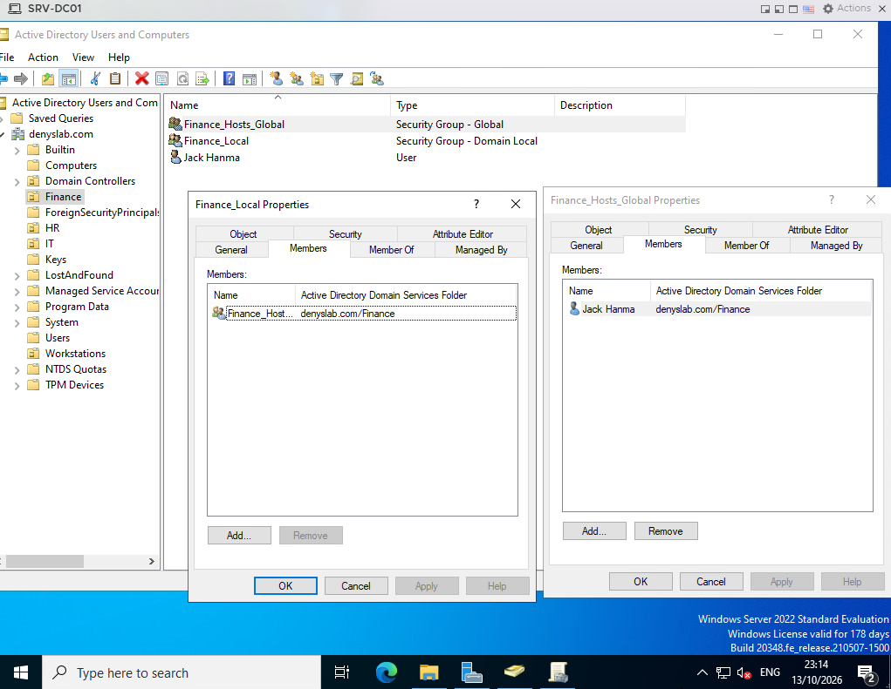
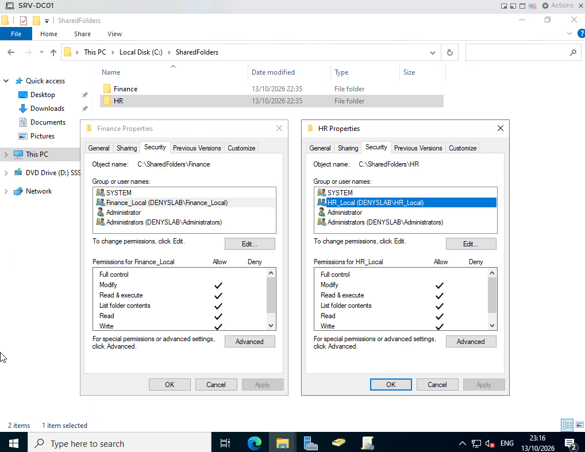
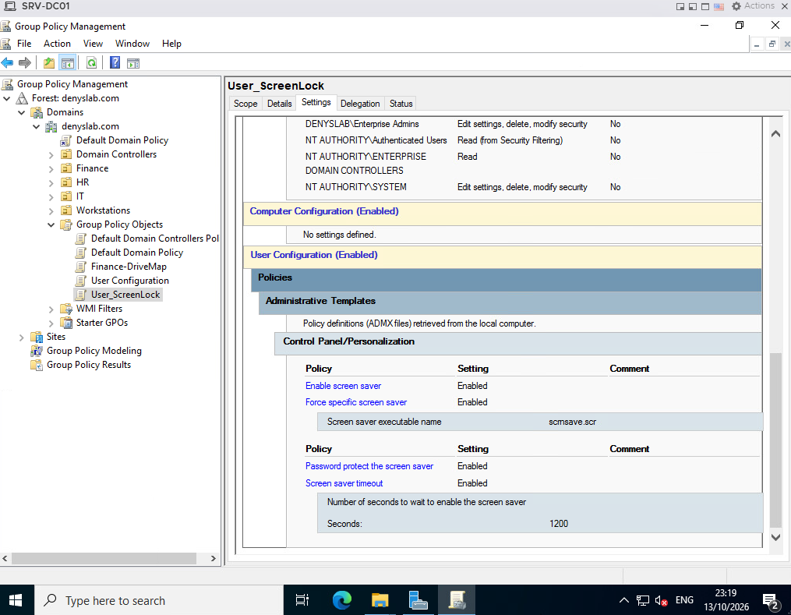
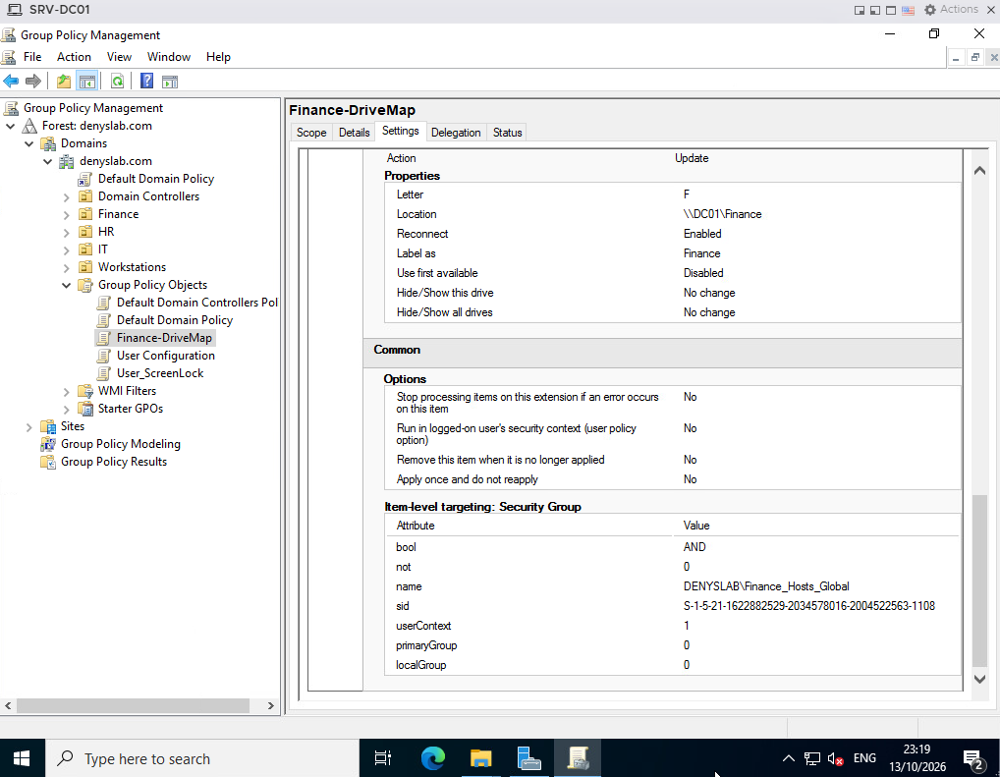
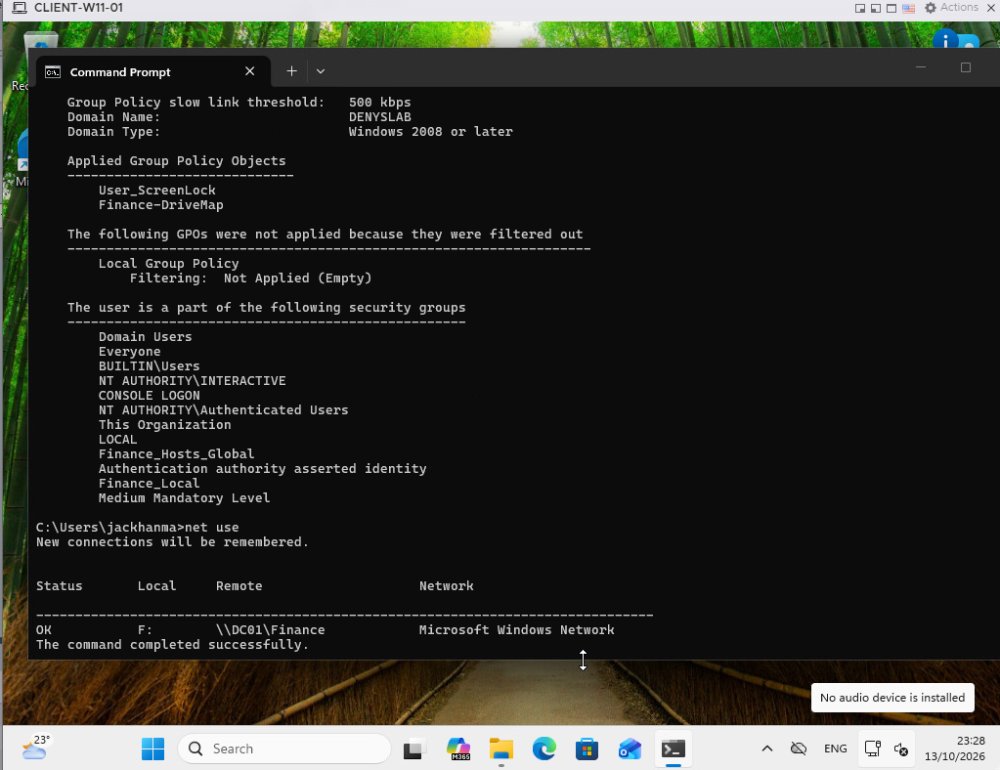
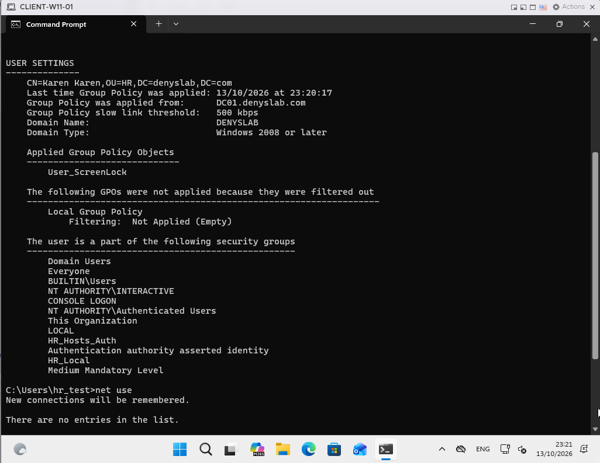
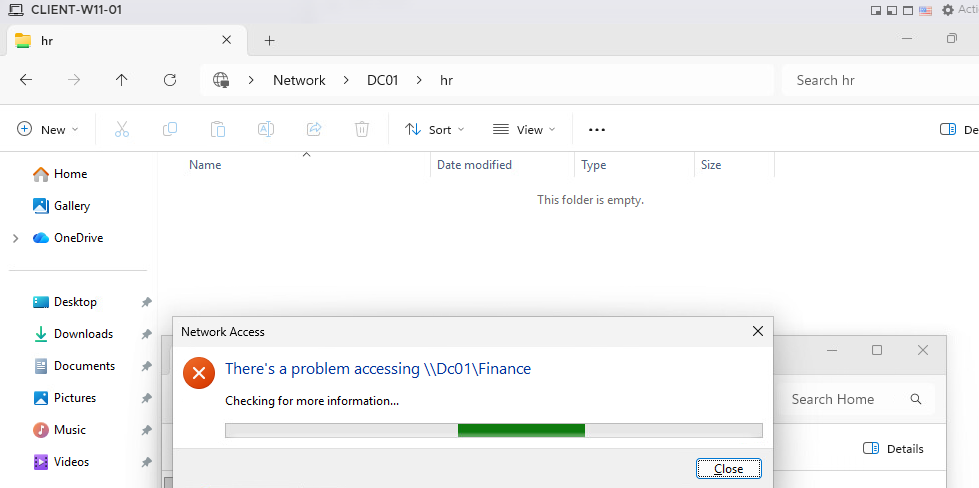

# Active Directory OUs, Group Policy, and File Access

I organized the domain accounts into department OUs, set up group-based access to two shared folders, and tested user policies on `CLIENT-W11-01`. All of this runs in the existing `denyslab.com` domain, with `DC01` providing the shares for this small lab.

## Requirement

I wanted Finance and HR users to access their own files without giving everyone access to both departments. I also wanted to apply one screen saver policy to the department accounts and map a Finance drive automatically, instead of asking users to connect it by hand.

## Design

The lab uses the `Finance`, `HR`, `IT`, and `Workstations` OUs. The Finance account is `jackhanma` (Jack Hanma); the HR test account is `hr_test` (Karen Karen). `CLIENT-W11-01` is the domain-joined Windows 11 test machine.

I kept permissions separate from user accounts. For Finance, `Finance_Hosts_Global` is a global security group containing Jack Hanma, and that group is a member of the domain-local `Finance_Local` group. The `Finance_Local` group has Modify permission on the Finance folder. HR uses `HR_Local` for the HR folder's Modify permission; the HR test user's logon token also includes `HR_Hosts_Auth` and `HR_Local`.

The shares live on `DC01` under `C:\SharedFolders`:

| Folder | Network path | NTFS group with Modify |
| --- | --- | --- |
| `Finance` | `\\DC01\Finance` | `Finance_Local` |
| `HR` | `\\DC01\HR` | `HR_Local` |

I used the domain controller for file sharing to keep the VM count down. A separate file server can be added later; this isn't meant to be a production file-server design.

## Implementation

### OUs and security groups

In Active Directory Users and Computers, I placed the Finance account and its groups in the `Finance` OU. I assigned the user to `Finance_Hosts_Global` and nested that group inside `Finance_Local`. This lets me change department membership without assigning folder permissions to each user individually.

*Jack Hanma belongs to `Finance_Hosts_Global`, which is a member of `Finance_Local`.*

### Shared folders and permissions

I created `Finance` and `HR` under `C:\SharedFolders` on `DC01`. The Security tab shows Modify permission for `Finance_Local` on Finance and `HR_Local` on HR. SYSTEM and administrative entries are also present. I used different groups on the two folders rather than granting broad access to all domain users.

*The two folders have separate domain-local groups with Modify permission.*

### Group Policy

I configured two user GPOs with different purposes:

- `User_ScreenLock` enables the screen saver, requires a password when resuming, forces `scrnsave.scr`, and sets the timeout to **1200 seconds (20 minutes)**.
- `Finance-DriveMap` uses Group Policy Preferences to map `\\DC01\Finance` as drive `F:` with **Update** and **Reconnect** enabled. Item-level targeting checks membership in `DENYSLAB\Finance_Hosts_Global`.

*The screen saver policy has a 1200-second timeout and password protection enabled.*

*The Finance mapping uses drive `F:` and targets the Finance global group.*

HR does not have an automatic drive-mapping GPO at this stage. Its share can still be opened by its network path.

## Validation

### Finance user

I signed in to `CLIENT-W11-01` as `DENYSLAB\jackhanma` and checked the applied user policies with `gpresult /r /scope:user`. Both `User_ScreenLock` and `Finance-DriveMap` appeared in the applied list. The `net use` output showed drive `F:` connected to `\\DC01\Finance`. The user's group list also included `Finance_Hosts_Global` and `Finance_Local`.

*Both GPOs applied to the Finance user, and `F:` points to the Finance share.*

### HR user

I repeated the check while signed in as the HR test user, `hr_test`. The result showed `User_ScreenLock` applied, but not `Finance-DriveMap`; `net use` showed no mapped connections. This matches the intended setup, where only Finance gets an automatic drive mapping.

*The HR user received the screen saver GPO but no Finance drive mapping.*

I also opened the HR share in Explorer under the HR session, then tried to open `\\DC01\Finance`. The HR folder opened, while Windows displayed an error when trying to access Finance.

*The HR share is open; the attempt to open Finance shows a Windows network-access error.*

## Troubleshooting and remaining checks

The Finance share did not open in the HR test session. The screenshot was taken while Windows was still checking the error, so it does not show a final error code. I have not treated that dialog alone as proof of an NTFS `Access denied` result or identified a specific cause. The separate NTFS groups are visible in the server configuration, but the exact denial reason still needs a final error or an effective-access check.

The `gpresult` output confirms that `User_ScreenLock` was applied to both test users. I have not captured a separate test of the workstation locking after 20 minutes. The screenshots do not include a test of creating or editing files in either share.

## Next stage

The next stage is backup and restore testing. I plan to save the Windows configuration and share data outside the ESXi host, then restore a small test item to check that the backup can actually be used.