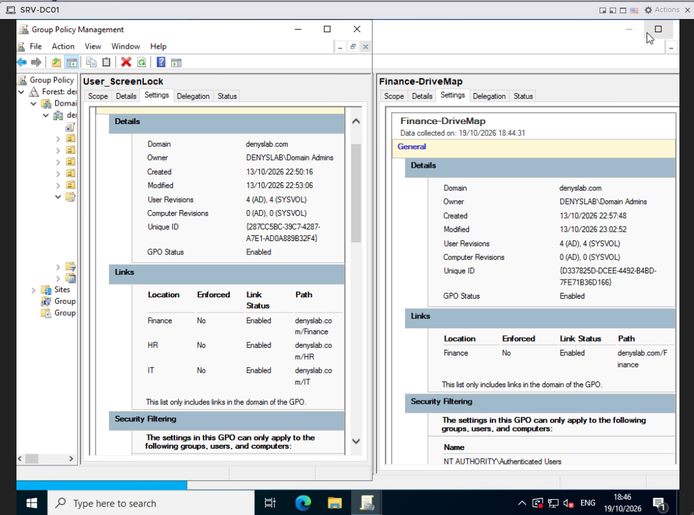
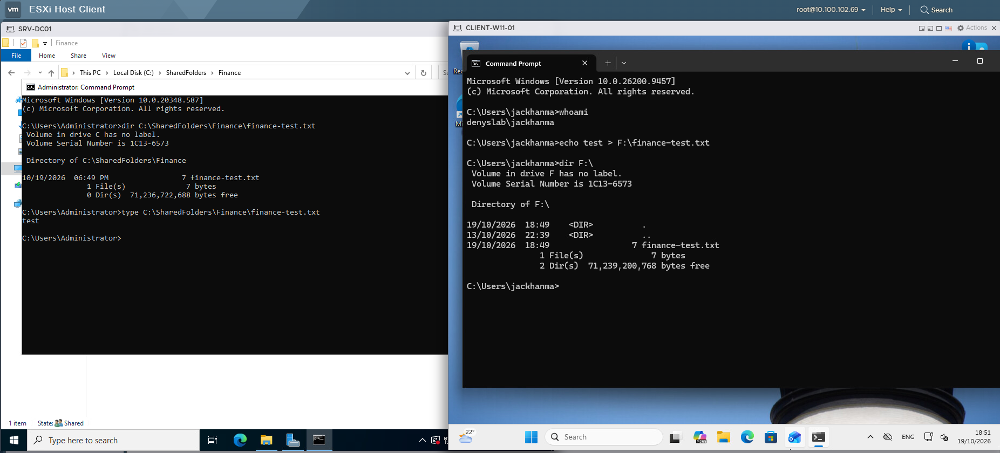

# OUs, Group Policy, and File Access

I set up department groups, two shared folders, and two user GPOs in `denyslab.com`. I tested the policies and file access on `CLIENT-W11-01` using Finance and HR accounts.

## Requirement

Finance and HR needed separate shared folders. I wanted folder permissions assigned to AD groups rather than individual users. I also needed a screen saver policy for both departments and an automatically mapped drive for Finance.

## Design

The domain has `Finance`, `HR`, `IT`, and `Workstations` OUs. I used `DC01` for the file shares because this lab runs on an ESXi host with 16 GB of RAM.

The computer object for `CLIENT-W11-01` was shown in the default `Computers` container after domain join. I have not checked whether it has since been moved into the `Workstations` OU.

For Finance, group membership and file permissions are kept separate:

`jackhanma` → `Finance_Hosts_Global` → `Finance_Local` → `\\DC01\Finance`

`Finance_Hosts_Global` contains the user; `Finance_Local` has Modify permission on the folder. This follows AGDLP (Account → Global group → Domain Local group → Permission).

The HR folder uses a different domain-local group, `HR_Local`, for the same NTFS permission level. The complete membership path through any HR global group has not been rechecked for this update.

The `_Hosts_` part of the Finance global group name is misleading because the group contains users. In a new design I would use a name such as `GG_Finance_Users` rather than rename the existing group and disrupt the documented tests.

The folders are stored at `C:\SharedFolders\Finance` and `C:\SharedFolders\HR`. They are shared as `\\DC01\Finance` and `\\DC01\HR`.

I used one GPO for screen saver settings and another for the Finance drive mapping. HR can open its share directly; I did not configure an HR drive mapping.

## Implementation

### Active Directory groups

In the `Finance` OU, I added Jack Hanma to the global security group `Finance_Hosts_Global` and added that group to the domain-local `Finance_Local` group.

*Finance group membership in Active Directory Users and Computers.*

### File permissions

On `DC01`, I configured separate NTFS permissions for the Finance and HR folders. `Finance_Local` has Modify permission on Finance, and `HR_Local` has Modify permission on HR. The SYSTEM and administrator entries are also present.

*Separate NTFS permissions for `Finance` and `HR`.*

The share-level permissions are not included in the current screenshot evidence and need a separate review. The NTFS and access tests below are documented independently of that check.

### Group Policy

`User_ScreenLock` enables the screen saver, selects `scrnsave.scr`, requires a password when resuming, and sets the timeout to **1200 seconds (20 minutes)**. The exact file name in the existing screenshot should be checked against the live setting before revising the evidence.

*Settings in the `User_ScreenLock` GPO; the screen saver file name is pending a closer screenshot check.*

`Finance-DriveMap` maps `\\DC01\Finance` to drive `F:`. The action is `Update`, `Reconnect` is enabled, and item-level targeting checks membership in `DENYSLAB\Finance_Hosts_Global`.

*Drive `F:` and the Finance group filter in Group Policy Preferences.*

The GPMC Scope views show `User_ScreenLock` linked to the `Finance`, `HR`, and `IT` OUs, and `Finance-DriveMap` linked to the `Finance` OU. All four links shown in the screenshot are enabled.

*Link locations of both GPOs in Group Policy Management.*

## Validation

### Finance

I signed in to `CLIENT-W11-01` as `DENYSLAB\jackhanma` and ran `gpresult /r /scope:user` and `net use`. Both `User_ScreenLock` and `Finance-DriveMap` appeared in the applied GPO list, and `F:` was connected to `\\DC01\Finance`.

*The Finance user received both GPOs. The mapped drive was checked separately with `net use`.*

I created `finance-test.txt` on drive `F:` as `jackhanma` and found the same file under `C:\SharedFolders\Finance` on `DC01`. I also checked its contents on the server.

*A file created through the mapped drive appears in the Finance folder on `DC01`.*

### HR

I repeated the checks as `hr_test`. `gpresult` listed `User_ScreenLock`, while `net use` showed no mapped drives. The Finance mapping was not applied to this account.

*The HR user received `User_ScreenLock` without the Finance drive mapping.*

I opened `\\DC01\HR` in File Explorer under the HR account. In the same session, `dir \\DC01\Finance` returned `Access is denied.`

*The HR share opened; the Finance share returned `Access is denied`.*

## Known Limitations

- The shares are hosted on the domain controller because the lab has only 16 GB of RAM. I would separate file services from a domain controller in a larger deployment.
- Windows Server is an evaluation build; its remaining evaluation period should be checked on the current VM before recording a number.
- The share permissions, HR global-group nesting, and current placement of the workstation computer object need direct checks before adding more detailed claims.

## Next stage

Next I will back up the Windows configuration and shared folder data outside the ESXi host, then test restoring a file.
