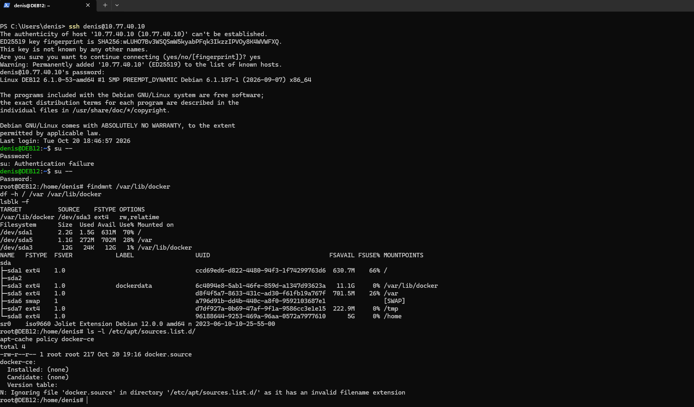
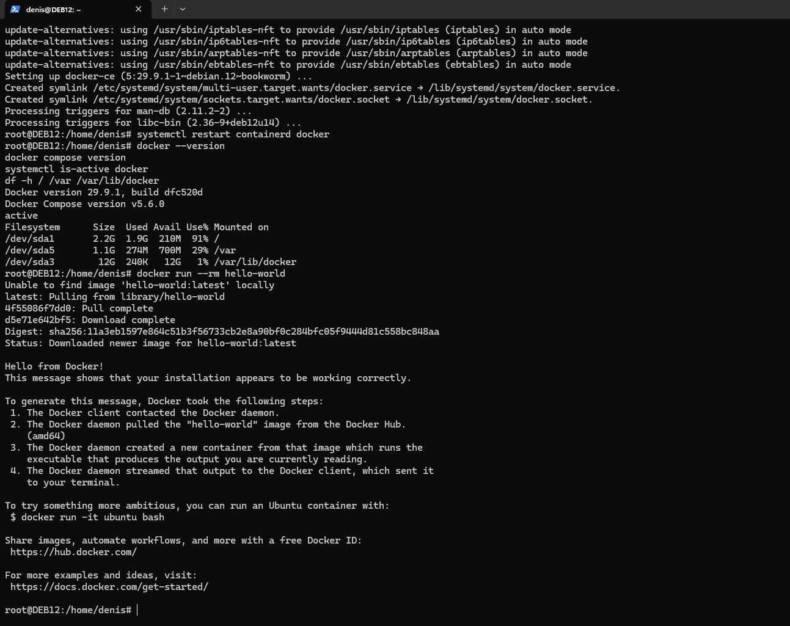

# Linux and Docker

I already had Debian 12 running on `DEB12` for network tests, so I used the same VM for Docker. The ESXi host has 16 GB of RAM, and I didn't want another VM just to run a few containers.

## Requirement

I needed SSH access from my Windows PC, a working Docker installation, and somewhere to keep container data without filling the Debian system partitions.

## Design

| Setting | Value |
| --- | --- |
| VM / OS | `DEB12` / Debian 12 (Bookworm) |
| Network | `OPS`, VLAN 40 |
| IP / gateway | `10.77.40.10/24` / `10.77.40.1` |
| VM memory | 2 GB |
| Virtual disk | 22 GB |
| Docker storage | `/dev/sda3`, ext4, about 12 GB, mounted at `/var/lib/docker` |

Debian was installed with separate partitions for `/`, `/var`, `/tmp`, and `/home`. Increasing the virtual disk in ESXi didn't enlarge any of those partitions. I used the newly available space for Docker instead of moving the existing partitions.

## Implementation

### SSH access

Typing commands in the ESXi console was slowing me down. I installed OpenSSH on Debian and connected from Windows Terminal instead.

My Windows PC is on the home network, so I added a route to `10.77.40.10` through the Sophos WAN address (`10.100.102.70`). I also added the `MAIN_TO_DEB12_SSH` firewall rule. After that, `ssh denis@10.77.40.10` worked from the PC.

*SSH connection from Windows Terminal to DEB12.*

### Disk space for Docker

The virtual disk showed 22 GB, but the root filesystem was still only about 2.2 GB. I checked the partition table before making changes. There was enough unallocated space to create a new primary partition without touching the existing Linux filesystems.

I created `/dev/sda3`, formatted it as ext4, and mounted it at `/var/lib/docker` using its UUID in `/etc/fstab`. That gave Docker a separate 12 GB filesystem.

I also changed the containerd data root to `/var/lib/docker/containerd-store`. Otherwise, container images would have used `/var/lib/containerd` on the much smaller `/var` partition. After moving the existing data and restarting the services, the effective containerd configuration showed the new path.

### Docker Engine and Compose

I installed Docker Engine and the Compose plugin from Docker's Debian repository. The versions shown during testing were:

- Docker Engine `29.9.1`
- Docker Compose `v5.6.0`

The Docker service was running, and `docker run --rm hello-world` downloaded an image and started a container.

*Docker and Compose versions, storage mounts, and the hello-world test.*

## Validation

I checked the Docker service, the storage mounts, and the `hello-world` output. I then used this Docker installation to run PostgreSQL, Zabbix Server, and the Zabbix web interface. All three containers were running in the later check, so Docker was also tested with an actual lab workload.

The Zabbix setup and its results are in [Zabbix Monitoring](8-zabbix-monitoring.md).

## Troubleshooting

### APT couldn't find Docker

My first repository file was named `docker.source`. APT ignored it and couldn't find `docker-ce`. I replaced it with a valid `docker.list` entry, ran `apt update`, and checked the available package version before installing Docker.

### The new disk space wasn't in the root filesystem

After the ESXi disk resize, `df -h` still showed the old root filesystem size. `fdisk` showed that the extra space was unallocated. I created `/dev/sda3` there and mounted it separately for Docker.

### Containerd was writing to the small /var partition

`containerd config dump` showed `/var/lib/containerd` as the data root. I stopped Docker and containerd, copied the existing data to the new filesystem, updated `/etc/containerd/config.toml`, and restarted the services. The new root path appeared in the effective configuration, and Docker was running afterward.

## Follow-up

The Debian root filesystem is still small: the last check showed **91% usage**, with about **191 MB free**. The extra 12 GB is for Docker data, not for `/`.

