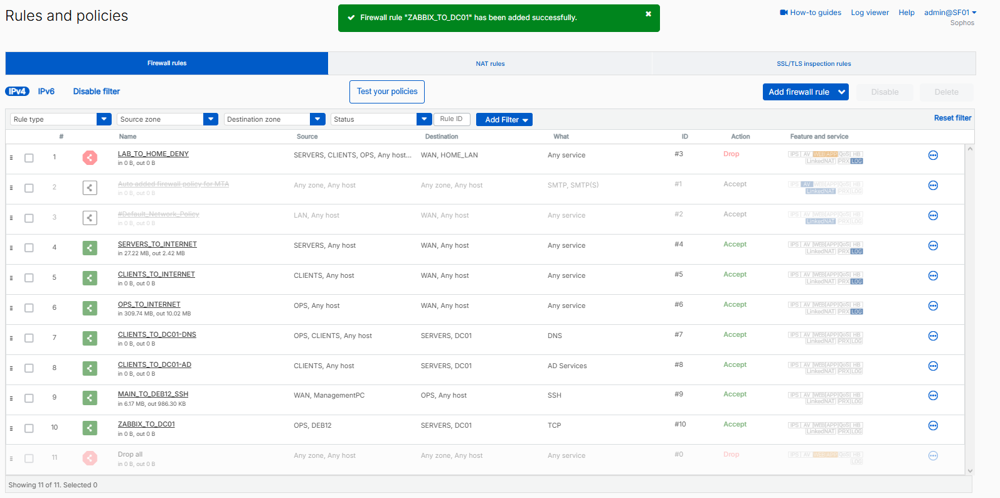
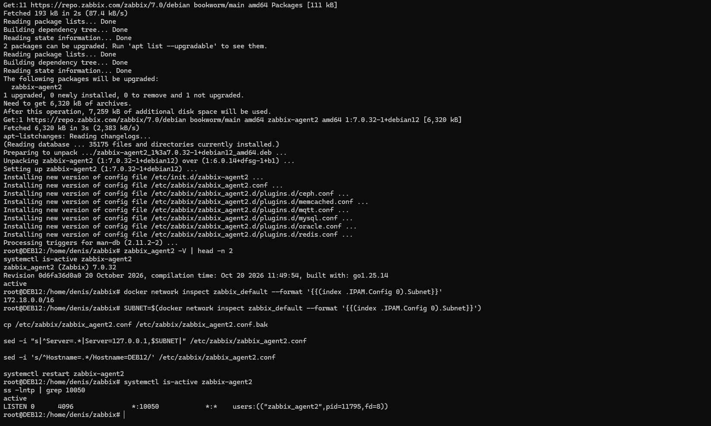
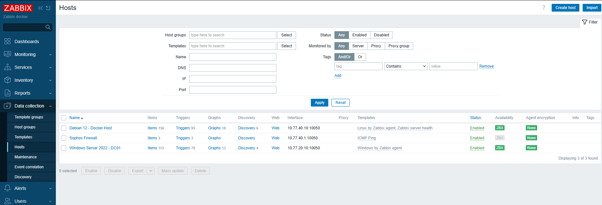
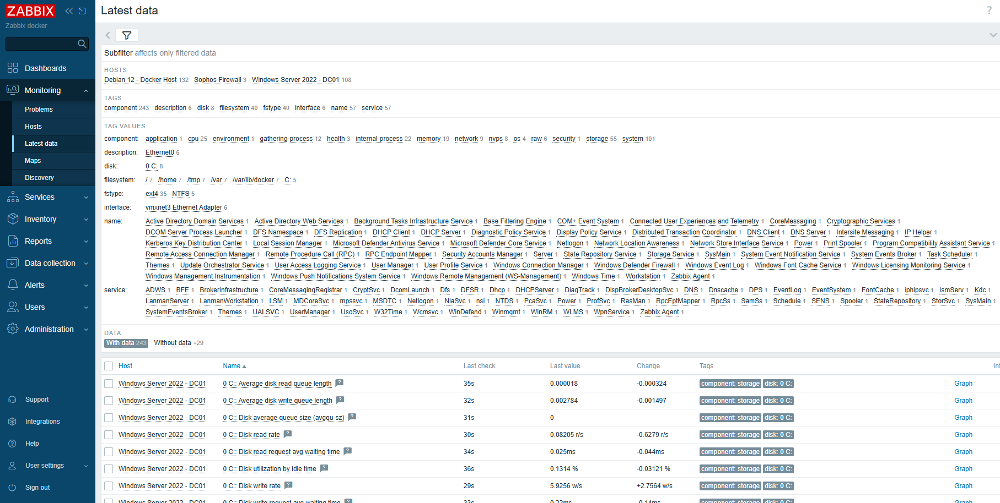
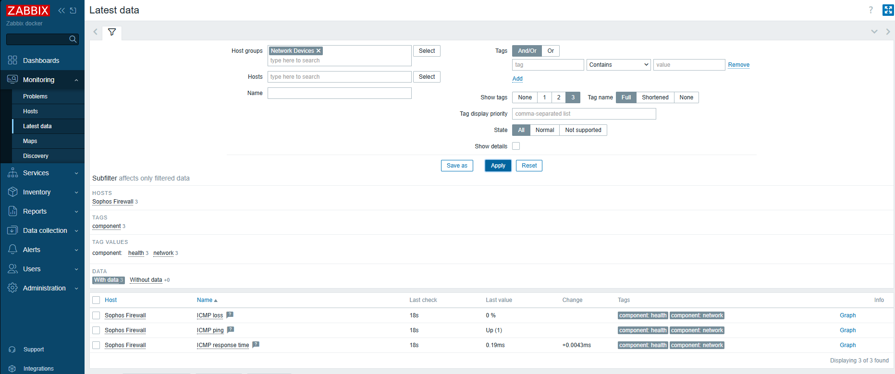
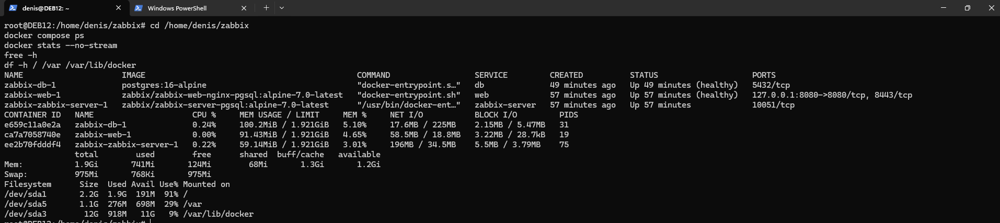
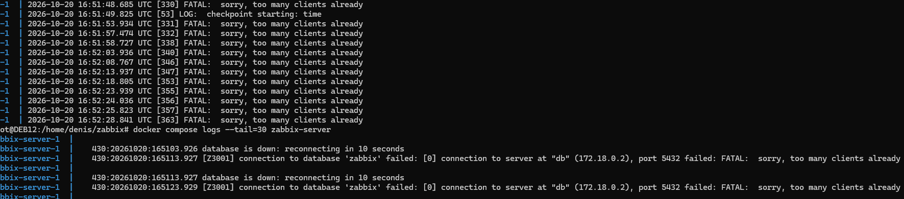

# Zabbix Monitoring

I ran Zabbix in Docker on `DEB12` to monitor the Debian host, Windows domain controller, and Sophos firewall.

## Requirement

I needed host availability checks and basic Linux and Windows metrics. Sophos is checked by ICMP.

## Design

Zabbix runs on `DEB12` (`10.77.40.10`, `OPS` network) with three Compose services:

| Service | Image | Role |
| --- | --- | --- |
| `db` | `postgres:16-alpine` | PostgreSQL database |
| `zabbix-server` | `zabbix/zabbix-server-pgsql:alpine-7.0-latest` | Zabbix Server |
| `web` | `zabbix/zabbix-web-nginx-pgsql:alpine-7.0-latest` | Web interface |

I kept the Compose files in `/home/denis/zabbix` and PostgreSQL data in a Docker volume. The database password stays in a local `.env` file.

### Compose configuration

I added a [sanitized Compose example](../configs/zabbix/compose.yaml) and an [environment template](../configs/zabbix/.env.example) to the repository. The example matches the three services, image tags, PostgreSQL connection limit, persistent database storage, and loopback web binding documented here. It is a reconstruction from the recorded setup, not a byte-for-byte export of the live file on `DEB12`.

To check the example without starting containers:

```bash
cd configs/zabbix
cp .env.example .env
# Set POSTGRES_PASSWORD in .env to a unique value.
docker compose config --quiet
```

The example does not contain passwords. I would compare it with `/home/denis/zabbix/compose.yaml` before applying it to the running lab.

The web container listens on `127.0.0.1:8080` on Debian. I reach it from my Windows PC through an SSH tunnel:

```powershell
ssh -N -L 8080:127.0.0.1:8080 denis@10.77.40.10
```

That lets me open `http://localhost:8080` without opening the Zabbix web port on Sophos.

## Implementation

### Zabbix Server and database

I started PostgreSQL 16, Zabbix Server 7.0 LTS, and the Nginx web frontend with Docker Compose. The first startup failed because PostgreSQL ran out of available client connections. I fixed the connection limit, and Zabbix started collecting data. The details are in Troubleshooting below.

### Linux and Windows agents

I installed Zabbix Agent 2 on `DEB12`. The Debian package I got first was version 6.0.14; after fixing the repository installation, I upgraded it to **7.0.32**. I allowed the Docker network (`172.18.0.0/16` at the time) in the agent configuration and changed the monitored interface from `127.0.0.1` to `10.77.40.10`.

I installed the Zabbix agent on `DC01` and linked the Windows monitoring template. In Sophos, I added `ZABBIX_TO_DC01` for traffic from `DEB12` in `OPS` to `DC01` in `SERVERS`. The DC01 agent then showed as available in Zabbix.



*Traffic rule from DEB12 to DC01 for Zabbix monitoring.*



*Agent 2 version 7.0.32 running on Debian and listening on TCP 10050.*

### Sophos availability

I added Sophos with the `ICMP Ping` template. I initially entered `10.77.20.10`, which is DC01's address, then corrected the target to the Sophos `OPS` interface at `10.77.40.1`.

## Validation

The final host list showed both Linux and Windows agents as available. Sophos uses ICMP, so it doesn't need a Zabbix agent.

| Host | Check | Result |
| --- | --- | --- |
| `Debian 12 - Docker Host` | Linux agent | Available |
| `Windows Server 2022 - DC01` | Windows agent | Available |
| `Sophos Firewall` | ICMP | Up, 0% loss |



*Debian, DC01, and Sophos in the Zabbix host list.*

The combined **Latest data** view had **243 items with readings** when I took the screenshot. I could see Windows disk activity and data from all three hosts. Another **29 items** had no readings at that point.



*Data collected from the three lab hosts.*

After correcting the Sophos address, I checked its ICMP values again: **Up (1)**, **0% packet loss**, and **0.19 ms response time**.



*ICMP results from the Sophos OPS interface.*

I checked container status, memory, and disk space on `DEB12`:

```bash
cd /home/denis/zabbix
docker compose ps
docker stats --no-stream
free -h
df -h / /var /var/lib/docker
```

PostgreSQL and the web container reported healthy, and Zabbix Server was running. PostgreSQL used about **100 MiB**, the web container **91 MiB**, and Zabbix Server **59 MiB**. Debian had about **1.2 GiB of available RAM**; the 12 GB Docker filesystem held **918 MiB** of data.



*Running containers and available resources on DEB12.*

## Troubleshooting

### Database connection error

The web page initially showed `Error connecting to database`. PostgreSQL logs said `FATAL: sorry, too many clients already`, and Zabbix Server was repeatedly trying to reconnect.

I had set `max_connections=30` in the PostgreSQL Compose settings. I increased it to **100** and applied the change without deleting the database volume. The web interface then loaded, and host data started appearing.



*PostgreSQL connection-limit errors during the first startup.*

### Debian agent showed unavailable

The original Zabbix host entry used `127.0.0.1:10050`, which pointed inside the Zabbix container rather than to Debian. I installed Agent 2 on the host, fixed the agent repository setup, allowed requests from the Docker network, and set its Zabbix interface to `10.77.40.10:10050`. The availability indicator turned green.

### The Sophos check was pointed at DC01

The first Sophos host entry used `10.77.20.10` by mistake. I changed it to `10.77.40.1` and checked the ICMP values again.

## Scope of checks

The combined Latest data screenshot showed **29 items without readings**. Alert delivery and database restore were not tested. The `ZABBIX_TO_DC01` firewall rule displayed a `TCP` service; its exact port scope was not verified. The initial Zabbix administrator password was unchanged at the last check, while web access was limited to an SSH tunnel.

## Project overview

[Back to the Infrastructure Homelab overview](../README.md).
